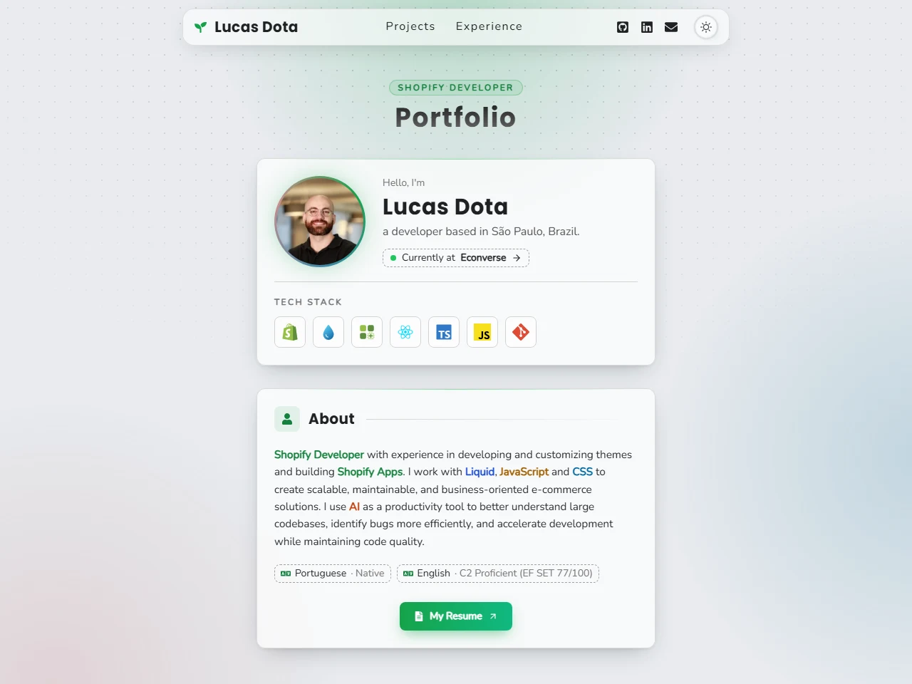

<div align="center">

# Lucas Dota · Portfolio

**Shopify Developer** based in São Paulo, Brazil, building themes, Shopify Apps and e-commerce experiences with Liquid, JavaScript and CSS.

[**View the live site →**](https://portfolio-virid-tau-44.vercel.app/)


<br />

<a href="https://portfolio-virid-tau-44.vercel.app/">
  <picture>
    <source media="(prefers-color-scheme: dark)" srcset=".github/assets/preview-dark.webp">
    
  </picture>
</a>

</div>

## About

Shopify Developer with experience in developing and customizing themes and building Shopify Apps. I work with Liquid, JavaScript and CSS to create scalable, maintainable, and business-oriented e-commerce solutions. I use AI as a productivity tool to better understand large codebases, identify bugs more efficiently, and accelerate development while maintaining code quality.

🇧🇷 Portuguese: native &nbsp;·&nbsp; 🇺🇸 English: C2 Proficient (EF SET 77/100)

## What's inside

| Page | What you'll find |
| --- | --- |
| **Home** | Profile, tech stack, about, languages, resume and a roadmap timeline |
| **Projects** | Selected work, each with a screenshot you can click to zoom |
| **Experience** | Professional timeline with the highlights of each role |

## Featured projects

| Project | Summary | Stack | Links |
| --- | --- | --- | --- |
| **Shopify Stores** | Themes built and customized across multiple Shopify stores (header, hero banners, shelves, PLPs, PDPs and institutional pages), extended with third-party apps and custom apps built from scratch. | Liquid · Cloudflare · Polaris · JavaScript · CSS | — |
| **Instagram Post Grid** | "InstaGrid", a Shopify app that connects a merchant's Instagram Business/Creator account and displays a curated grid of posts on the storefront. | Shopify App · React · Instagram API · Cloudflare Worker | [LinkedIn post](https://lnkd.in/p/dFhc4ber) |
| **Shopify Inventory Check** | Checks stock in the merchant's ERP before a product can be added to the cart, through a Cloudflare Worker that keeps sensitive data away from the front end. | Shopify · Liquid · JavaScript · Cloudflare Worker | [LinkedIn post](https://lnkd.in/p/d5JrMn5X) |
| **To Do App** | Full-stack to-do list with registration, login and JWT authentication stored in cookies. | Java · Spring Boot · JWT · PostgreSQL · React | [Repository](https://github.com/Lucasdota/todo_app_backend) |
| **GrocerGo** | Frontend supermarket with Google/GitHub login, product search, cart and recipe search. | React · Tailwind CSS · Framer Motion | [Website](https://grocergo.vercel.app/) · [Repository](https://github.com/Lucasdota/GrocerGo) |

## Design highlights

- **Glass cards** with a green spotlight that follows the cursor, plus a custom green cursor
- **Two backgrounds**, one for dark and one for light mode: a dot grid with slowly drifting glows (motion is turned off for visitors who prefer reduced motion)
- **Scroll-drawn timelines** for the roadmap and the experience page
- **Small details**: an animated ring around the profile photo, a sliding active-page indicator and page transitions
- **Dark/light theme toggle**, remembered between visits

## Tech stack

- [Next.js 13](https://nextjs.org/) (pages router), [React 18](https://react.dev/) and [TypeScript](https://www.typescriptlang.org/)
- [Tailwind CSS](https://tailwindcss.com/) for styling and [Framer Motion](https://www.framer.com/motion/) for animations
- [MUI](https://mui.com/) for tooltips and media queries, [React Icons](https://react-icons.github.io/react-icons/) for icons
- Deployed on [Vercel](https://vercel.com/)

## Getting started

Requires **Node.js 24** (see [`.nvmrc`](.nvmrc)).

```bash
git clone https://github.com/Lucasdota/portfolio.git
cd portfolio
npm install
npm run dev
```

Then open [http://localhost:3000](http://localhost:3000).

| Script | What it does |
| --- | --- |
| `npm run dev` | Starts the development server |
| `npm run build` | Creates the production build (also runs lint and type checks) |
| `npm start` | Serves the production build |
| `npm run lint` | Runs ESLint |

## Project structure

```
src/
├── components/
│   ├── ui/            # shared building blocks: Card, Page, Pill, Keyword, Technologies...
│   ├── projects/      # ProjectCard and one component per project
│   ├── experience/    # ExperienceCard
│   └── ...            # Navbar, Hero, About, Roadmap, Footer, Background
├── pages/             # index, projects, experience and 404
└── styles/
    └── globals.css    # backgrounds, profile ring and custom cursor
public/                # images, icons and resume
```

To add a project, create a component in `src/components/projects/` that renders a `ProjectCard` (title, image, technologies, optional links and a description), then add it to `src/pages/projects.tsx`.

## Contact

[GitHub](https://github.com/Lucasdota) · [LinkedIn](https://www.linkedin.com/in/lucas-dota-trombini/) · [Email](mailto:lucasdotat@hotmail.com)

<div align="center">
<br />
<sub>Developer, develop yourself. 🌱</sub>
</div>
